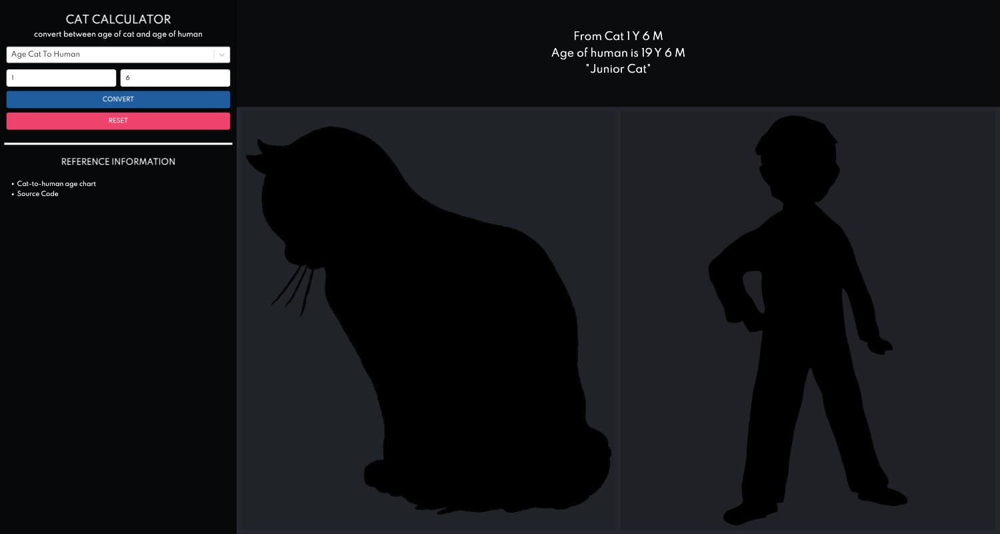

# Cat Calculator

A React app that estimates equivalent cat and human ages in both directions.

I built this project in March 2022 while learning React. This edition keeps the original layout and updates the conversion.



## Run locally

Use Node.js 24 and npm.

```sh
npm ci
npm start
```

Open `http://localhost:3000/cat-calculator/`. Enter years and months, select a direction, and choose **Convert**.

```sh
CI=true npm test -- --watchAll=false --runInBand
npm run build
```

## How ages are estimated

The estimates use the [FelineVMA and AAHA Cat Age to Human Age chart](https://catfriendly.com/wp-content/uploads/2025/09/FelineVMA_CatAgeToHumanAge.pdf). Its milestones include 1 cat month to 1 human year, 3 months to 4 years, 6 months to 10 years, 1 year to 15 years, and 2 years to 24 years. The app starts at zero for both ages, interpolates between the milestones, and uses four human years per cat year after year two. Reverse conversion follows the same chart in the other direction. Results are approximate and rounded to the nearest month.

## Built with

React 17, Create React App, styled-components, and react-select. The interface uses the Spartan font via Google Fonts.

## GitHub Pages

The production build targets [ntpon.github.io/cat-calculator](https://ntpon.github.io/cat-calculator/). The repository owner can use `npm run deploy` to publish the build to the `gh-pages` branch and select that branch and its root as the Pages source.

## License

The original application code is available under the [MIT License](LICENSE). The historic illustrations and photo have undocumented sources and are excluded from this license notice.
